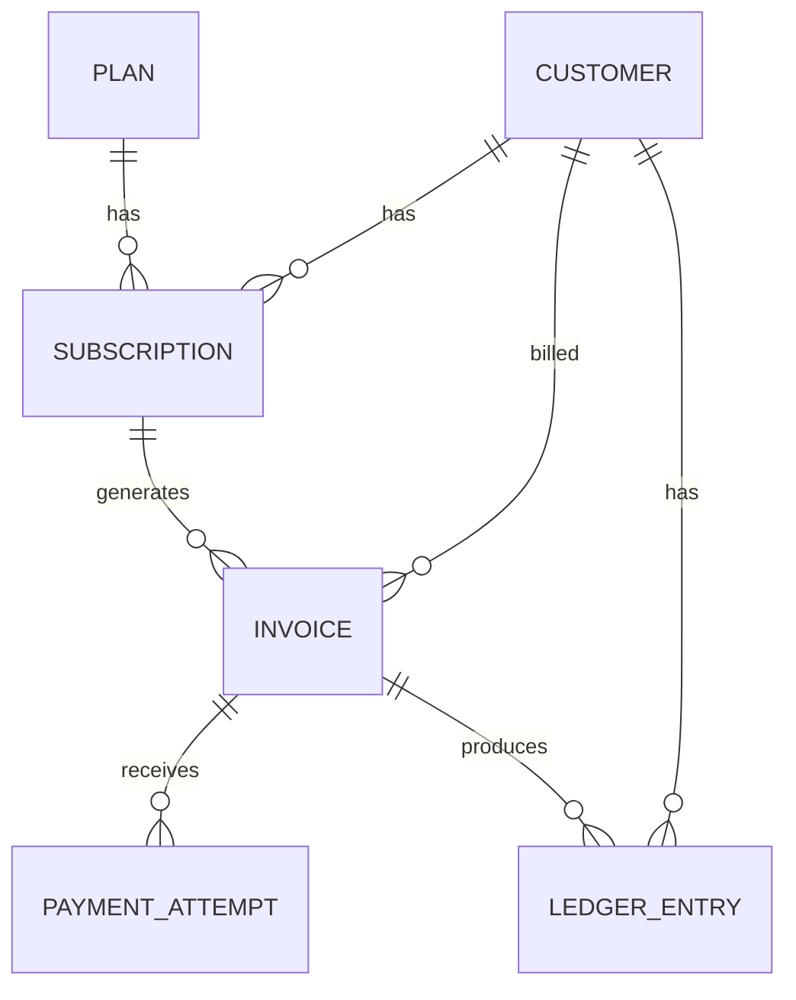

# SubLedger low-level design

## Scope and implementation status

SubLedger manages plans, customers, subscriptions, invoices, payment attempts,
and append-only ledger events. This document describes the implemented backend.
The current implementation contains configuration, database session setup,
the application skeleton, a health endpoint, all six database models, and an
three Alembic migrations. Plans, customers, subscriptions, and invoices have working
schemas, repositories, services, and endpoints. Invoice generation atomically appends
ledger events, and customer ledger history is available. Payment recording and
payment history are implemented with atomic invoice/ledger updates.

## Architecture

Requests flow through routes -> services -> repositories -> database.
Pydantic schemas validate input and serialize output. SQLAlchemy models define
tables and relationships. Configuration comes from environment variables or `.env`.

Routes translate HTTP requests and errors. Services own business rules and
transactions. Repositories query, add, and flush entities without committing.
One service transaction covers each invoice/payment operation and its ledger event,
so a failure rolls back both. Dependencies provide a session per request.

The repository pattern separates persistence from billing logic; service objects
coordinate use cases. FastAPI dependency injection supplies sessions and services.

## Entities and relationships

All entities have integer primary keys and UTC creation timestamps.

| Entity | Fields in addition to id and created_at |
| --- | --- |
| Plan | name, description, price, currency, billing_interval, is_active, updated_at |
| Customer | name, email (unique), company_name, status |
| Subscription | customer_id, plan_id, status, start_date, current_period_start, current_period_end, cancelled_at |
| Invoice | subscription_id, customer_id, amount_due, amount_paid, currency, status, period_start, period_end, due_date |
| PaymentAttempt | invoice_id, amount, currency, status, provider_reference, failure_reason |
| LedgerEntry | customer_id, invoice_id, event_type, amount, currency, reference_id, description |

Foreign keys preserve relationships. Monetary values use Decimal and fixed precision
numeric columns, never binary float arithmetic. Invoice amount and currency are
snapshots taken at generation time. Later plan changes do not change existing invoices.

## Service and repository responsibilities

| Service | Responsibilities | Repository |
| --- | --- | --- |
| PlanService | Validate price, create/list plans, manage activation | PlanRepository |
| CustomerService | Normalize email, enforce uniqueness, create/list customers | CustomerRepository |
| SubscriptionService | Check plan/customer, prevent duplicate active subscriptions, cancel | SubscriptionRepository |
| InvoiceService | Validate subscription, determine billing period, snapshot price, create invoice | InvoiceRepository |
| PaymentService | Validate payment, record attempt, update invoice totals and status | PaymentAttemptRepository, InvoiceRepository |
| LedgerService | Append traceable billing events within caller transaction | LedgerRepository |

Repositories expose get/create and relevant list/filter operations. Updates are
limited to domain operations. LedgerRepository exposes append/list only.

## Repository responsibilities

| Repository | Entities read/written | Common methods | Excludes |
| --- | --- | --- | --- |
| PlanRepository | Plan | create, get, list, update | Price policy, transactions |
| CustomerRepository | Customer | create, get, get_by_email, list | Normalization, HTTP errors |
| SubscriptionRepository | Subscription | create, get, get_active, list, cancel, set_period | Plan eligibility, duplicate policy |
| InvoiceRepository | Invoice | create, get, find_overlap, apply_payment | Billing-date calculation, payment validation |
| PaymentAttemptRepository | PaymentAttempt | create, get_by_reference, list_for_invoice | Currency/balance checks, provider calls |
| LedgerRepository | LedgerEntry | append, list_for_customer | Updates, deletes, commits |

Single-responsibility boundaries keep HTTP in routes, contracts in schemas, workflows
in services, and persistence in repositories. Services share the injected request
session; invoice/payment services compose LedgerService with that same session.

## Business-rule ownership

| Rule | Owner and persistence safeguard |
| --- | --- |
| Plan price > 0 | Plan schema/service; database check |
| Unique customer email | CustomerService; unique constraint after normalization |
| Active plan required for new subscription | SubscriptionService |
| At most one active subscription per customer and plan | SubscriptionService; partial unique index |
| Invoice requires active subscription | InvoiceService |
| Invoice snapshots current plan price | InvoiceService |
| Successful payment > 0 and <= unpaid balance | PaymentService; serialized invoice update |
| Currency matches invoice | PaymentService |
| Failed payment leaves amount_paid unchanged | PaymentService |
| Invoice status reflects paid total | PaymentService |
| Ledger entries are append-only and traceable | LedgerService, restricted repository interface, database mutation guards |

Validation failures return 422, missing entities 404, and state/uniqueness conflicts
409. Database integrity errors must be translated into stable HTTP errors.
Concurrent successful payments must serialize or use conditional updates so the
balance cannot be exceeded. Application checks alone do not provide that guarantee.

## Invoice generation flow

1. Receive subscription ID and optional billing period.
2. Load subscription; require it to exist and be active.
3. Load its plan and determine period and due date.
4. Snapshot plan price and currency; set amount_paid to zero and status to issued.
5. Create invoice and append invoice_created ledger entry in one transaction.
6. Commit and return the invoice.

## Payment recording flow

1. Receive invoice ID, positive amount, currency, status, and provider reference.
2. Load invoice and serialize balance-changing operations.
3. Validate currency and, for success, remaining unpaid balance.
4. Record payment attempt, including failure reason when applicable.
5. For success, increase amount_paid and set partially_paid or paid.
6. Append payment_success or payment_failure event in the same transaction.
7. Commit and return the attempt and invoice status.

## API surface

All endpoints below are implemented.

| Method | Path | Purpose |
| --- | --- | --- |
| POST / GET | /plans | Create/list plans |
| GET | /plans/{id} | Retrieve plan |
| PATCH | /plans/{id} | Update plan activation |
| POST / GET | /customers | Create/list customers |
| GET | /customers/{id} | Retrieve customer |
| POST / GET | /subscriptions | Create/list subscriptions |
| GET | /subscriptions/{id} | Retrieve subscription |
| POST | /subscriptions/{id}/cancel | Cancel subscription |
| PATCH | /subscriptions/{id}/cancel | Required assignment cancellation path |
| POST | /subscriptions/{id}/invoices | Generate invoice |
| POST | /invoices/generate | Required generation path; subscription_id in body |
| GET | /invoices/{id} | Retrieve invoice |
| POST / GET | /invoices/{id}/payments | Record/list payment attempts |
| POST | /payments/record | Required recording path; invoice_id in body |
| GET | /customers/{id}/ledger | List customer ledger events |

## Assumptions and limitations

Start with SQLite for local development. Monthly, quarterly, and annual billing use calendar
boundaries, clamping invalid days to the last day of the target month. Dates and
timestamps use UTC. The initial monetary scale is two decimal places; currency
codes are restricted to INR, USD, EUR, and GBP in plan creation. Plan prices are
validated as positive Decimal values with at most two decimal places and twelve
total digits. Payment schemas apply the same precision policy.
There is no automatic charging, payment gateway, tax, proration, refund, scheduler,
or authentication in the initial scope. Payment status is supplied for simulation.
Provider references are trimmed, case-sensitive, and globally unique across all
attempts; reused references return 409 rather than replaying the previous response.
Invoice periods for a subscription must not overlap. The initial migration creates
all six billing tables, indexes, and SQLite ledger mutation guards. A second migration
replaces the provider reference lookup index with a unique index. It does not
automatically repair duplicate existing data. Success/failed are the stored payment status values;
subscription statuses are active/cancelled and intervals are monthly/quarterly/annual.
A third migration adds plan description/updated_at, customer company/status,
subscription billing periods, ledger descriptions, and overdue/void invoice states.
Existing subscriptions use the latest invoice period if available; otherwise their
start date and plan interval determine the backfill. IDs and relations are preserved.
Downgrade requires no quarterly plans or overdue/void invoices, since those values
cannot be represented in the previous schema.

Assignment names are supported alongside existing names: plan billing_cycle maps
to billing_interval (yearly -> annual), status maps to is_active, and ledger entry_type
maps to event_type. Responses include both names without storing duplicate state.
Plan patches support all editable catalog fields and preserve prior invoice snapshots.
Customer contact details use email and optional company_name. Stored customer status
does not add an eligibility restriction beyond the required active-plan rule.

SQLite is the currently supported database. The partial unique index enforces
one active subscription per customer/plan while preserving cancelled history.
Invoice constraints enforce valid balances/statuses, but payment-to-invoice currency,
customer ownership, active-plan checks, and atomic ledger creation remain service
responsibilities. Numeric(12, 2) exposes Decimal values through SQLAlchemy; SQLite
does not enforce two-decimal storage precision, so service validation and arithmetic
must also enforce that scale, as the plan schema already does. UTCDateTime rejects naive model input and restores
UTC timezone information on SQLite reads. Run migrations rather than create_all
to install database triggers.

## Implemented request behavior

Plan and customer routes delegate to services; services own write transactions.
Repositories flush but do not commit. Create schemas forbid unknown fields and
trim names; plan activation requires a JSON boolean. Customer emails are validated,
trimmed, and lowercased before lookup and insertion. A precheck provides a readable
duplicate-email error, and the unique constraint covers an insert that races the
precheck. After rollback, the service confirms that email exists before translating
the integrity error to a conflict. Unexpected integrity errors propagate.

Domain errors are translated to 404/409 by application exception handlers. Pydantic
request validation returns 422. List routes order by ID and accept offset >= 0 and
limit from 1 to 100 (default 20). Input schemas enforce field lengths. Response
schemas serialize Decimal amounts as strings and timestamps as UTC values.

Subscription creation requires existing customer and plan records, an active plan,
and no active subscription for that pair. IDs are positive strict integers; clients
cannot supply status or dates. Missing records return 404 and state conflicts 409.
On SQLite, `write_transaction` issues BEGIN IMMEDIATE before reading state to
serialize subscription writes. The partial unique index is a second safeguard;
uniqueness failures are translated only after rollback and confirmation of an
existing active subscription. Other database engines need separate locking design.

Cancellation is immediate and idempotent: an active subscription gets a UTC
cancelled_at timestamp; an already cancelled record is returned unchanged. Cancelled
records stay in history. Resubscription creates a new row if the plan remains active.
Plan deactivation does not cancel existing subscriptions. No invoice, refund, or
ledger operation is currently attached to cancellation. Subscription lists support
combined customer_id, plan_id, and active/cancelled status filters before pagination.

Invoice generation uses the same SQLite write transaction as subscription writes.
It requires an active subscription, reads the plan even when deactivated, snapshots
price and currency, inserts an issued invoice, then appends invoice_created with
reference_id `invoice:<id>`. The outer transaction commits both inserts together.
LedgerService and LedgerRepository never commit independently. Customer ownership
is copied from the subscription and cannot be supplied by the caller.

Subscription creation initializes its current period using the plan cycle. Generating
a period at or after current_period_start updates both period fields in the invoice
transaction; earlier historical generation does not move them back.
The default invoice start is always subscription.start_date, not the current date or the end
of the latest invoice. A missing end adds one calendar month, quarter, or year to the start,
clamping invalid days; callers may supply explicit boundaries for later periods.
Inferred boundaries use the supplied start's day, so a clamped date may shift the
next inferred boundary. The due date defaults to start + seven days. Timezone-aware
input is normalized to UTC. Invalid ranges, periods before subscription start, and
datetime overflow return 422. Custom periods are charged the full price with no
proration; future periods are permitted for manual billing.

Existing periods use half-open intervals [start, end). Overlap checks reject exact,
contained, containing, and partially overlapping intervals with 409. Adjacency is
allowed. BEGIN IMMEDIATE serializes the check and inserts on SQLite; direct database
writes can bypass this service rule. There is no automatic advancement or recurring
invoice scheduler. Customer ledger reads verify the customer exists, filter by that
customer, order by ID, and apply pagination. Ledger amounts describe events rather
than signed debits/credits or a computed customer balance.

Payment recording starts a SQLite write transaction before reading invoice state.
It checks invoice existence, duplicate reference, non-draft state, matching currency,
and (for success) sufficient unpaid balance. Failed attempts require a nonblank
reason; successful attempts must have no reason. The schema rejects nonpositive,
nonfinite, overprecision amounts and unknown fields. The service creates an attempt,
updates the invoice for success, and appends a payment_success/payment_failure event
referencing `payment:<attempt_id>` in the same transaction. Failure anywhere rolls
back the attempt, invoice update, and ledger entry. Decimal arithmetic determines
partially_paid versus paid. The database independently constrains invoice balances.

Draft and void invoices reject all attempts. Issued, overdue, partially_paid, and paid invoices accept
failed attempts without changing status or totals; failed amounts may exceed the
unpaid balance since no money is applied. Successful payments must fit the remaining
balance, including zero remaining on a paid invoice. Subscription cancellation and
plan activation do not affect payment of an existing invoice. Duplicate attempts
return 409 even when payloads match. Retrying a failed attempt requires a new
provider reference. After rollback, integrity failures are translated to reference
conflicts only when an existing attempt confirms the duplicate. Unexpected errors
propagate. Payment-history reads verify the invoice exists and paginate by ID.
Overdue/void are supported stored states; no scheduler or lifecycle API assigns them.
Generation produces issued status. Successful payments on overdue invoices move
them to partially_paid or paid according to their balance.

## Validation

The database test suite currently covers migration upgrade/downgrade/re-upgrade,
metadata consistency, positive prices, unique normalized email, foreign keys,
duplicate active subscriptions, resubscription after cancellation, model relationships,
Decimal and UTC round trips, invoice snapshots, balance/status constraints,
failure reasons, and append-only ledger triggers using direct SQL.

API tests additionally cover plan creation/read/activation, invalid prices and
currencies, input lengths, unknown fields, normalized duplicate emails, database
uniqueness conflicts after a missed precheck, request rollback, missing entities,
pagination, and OpenAPI availability.

Subscription tests cover missing customer/plan records, inactive plans, duplicate
active subscriptions (including database-constraint conflicts), creation and retrieval,
combined filters, pagination, invalid input, cancellation, repeated cancellation,
resubscription, plan deactivation, and two concurrent creation attempts. The concurrent
test verifies exactly one creation, one conflict, and one persisted subscription.

Invoice tests cover calendar month/year boundaries, leap days, UTC normalization,
custom periods, default due dates, amount/currency snapshots, overlapping periods,
invalid dates, missing entities, cancelled subscriptions, deactivated plans, customer
ledger isolation/pagination, and concurrent duplicate invoice requests. A failure
injected after ledger insertion verifies both invoice and ledger rows roll back.

Payment tests cover partial/full settlement, exact decimal sums, remaining-balance
overpayment rejection, failed attempts, currency mismatches, duplicate references
including across invoices and database conflicts, input validation, history pagination,
draft rejection, and payment after cancellation. Failure injection after ledger insert
checks rollback of the payment, invoice, and event. Concurrent requests with shared
and distinct references verify exactly one payment when both cannot fit the balance.
When both fit, the concurrency test verifies both payments and events persist and
the invoice total includes both amounts without lost updates.
